# Flussi di node-comtypes

Questo documento descrive i flussi implementati, non una proposta architetturale.
Uso dell'API ed esempi sono nel [README](./README.md).

Verifica sul codice: **9 novembre 2026**.

L'import non carica DLL: `ole32.dll` e `oleaut32.dll` vengono aperte alla prima chiamata nativa
(`low-level/native.ts`). I prototipi `WINFUNCTYPE` dei metodi vengono creati al primo binding di uno slot, le
callback delle vtable dei `COMObject` alla prima istanza della classe (solo il prototipo di `pfnDeferredFillIn`,
in `automation/dispatch.ts`, viene creato all'import, senza caricare DLL). Per questo GUID, HRESULT e definizioni di interfaccia funzionano anche su Linux e macOS.

## Indice

1. [Architettura a livelli](#1-architettura-a-livelli)
2. [Definizione di un'interfaccia](#2-definizione-di-uninterfaccia)
3. [Chiamata di un metodo vtable](#3-chiamata-di-un-metodo-vtable)
4. [Errori HRESULT e IErrorInfo](#4-errori-hresult-e-ierrorinfo)
5. [Ownership dei puntatori](#5-ownership-dei-puntatori)
6. [Apartment e rilascio finale](#6-apartment-e-rilascio-finale)
7. [VARIANT e SAFEARRAY](#7-variant-e-safearray)
8. [IDispatch::Invoke](#8-idispatchinvoke)
9. [Client: best interface e client dinamico](#9-client-best-interface-e-client-dinamico)
10. [COMMETHOD e idlflags](#10-commethod-e-idlflags)
11. [DISPMETHOD e DISPPROPERTY](#11-dispmethod-e-dispproperty)
12. [COMObject](#12-comobject)
13. [Eventi e message pump](#13-eventi-e-message-pump)
14. [Class factory e LocalServer32](#14-class-factory-e-localserver32)
15. [Type library](#15-type-library)
16. [Generazione dei moduli](#16-generazione-dei-moduli)
17. [Interfacce predefinite](#17-interfacce-predefinite)
18. [ByRef, record e thread](#18-byref-record-e-thread)
19. [Limitazioni note](#19-limitazioni-note)
20. [Riferimenti al codice](#riferimenti-al-codice)

## 1. Architettura a livelli

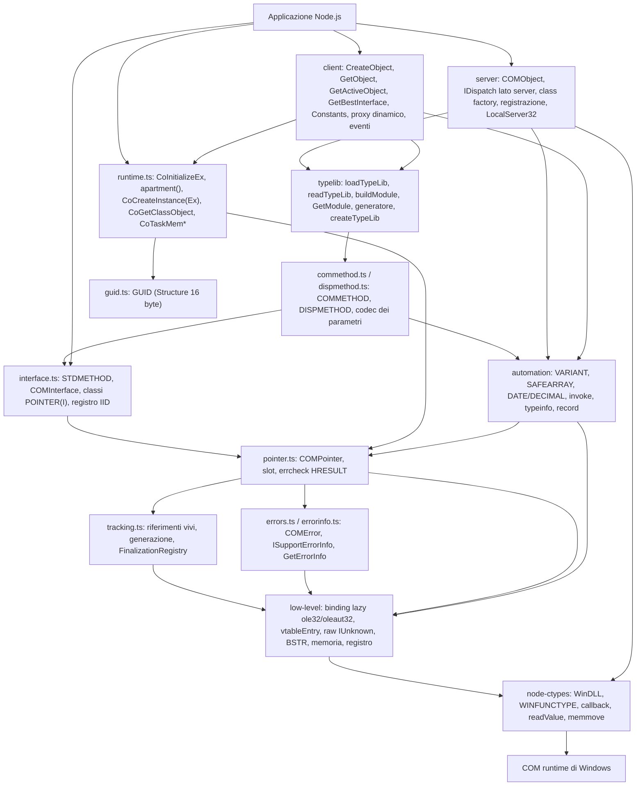

## 2. Definizione di un'interfaccia

`COMInterface({ name, iid, extends, methods, dispMethods, register })`:

1. copia l'IID in un nuovo `GUID` e congela la lista dei metodi; i nomi duplicati sono un errore. I membri
   `DISPMETHOD`/`DISPPROPERTY` vanno in `dispMethods` (non hanno uno slot vtable) e sono rifiutati in `methods`;
2. crea uno `Slot` per ogni metodo proprio, che ricorda l'interfaccia dichiarante (nome e IID);
   gli slot della base vengono riusati, quindi l'indice vtable di un metodo e' lo stesso
   in tutte le interfacce derivate;
3. genera `class POINTER(Name) extends base.Pointer` (o `COMPointer`) e installa sul
   prototype un metodo per ogni metodo proprio; i nomi gia' presenti su `COMPointer`
   (`QueryInterface`, `AddRef`, `Release`) non vengono sovrascritti, come in comtypes;
4. installa le proprieta' JS degli accessor (`installProperties`, sezione 10) e i membri di dispatch
   (`installDispatchMembers`, sezione 11, che sintetizza anche `_set_X` per i `DISPPROPERTY` scrivibili);
5. restituisce una definizione congelata e, salvo `register: false`, la registra per IID (vince la definizione
   piu' recente; `findInterface(iid)`). Il tipo statico accumula le firme in un campo fantasma `__methods`, da
   cui `InterfacePointer<I>` ricava i metodi tipizzati.

## 3. Chiamata di un metodo vtable

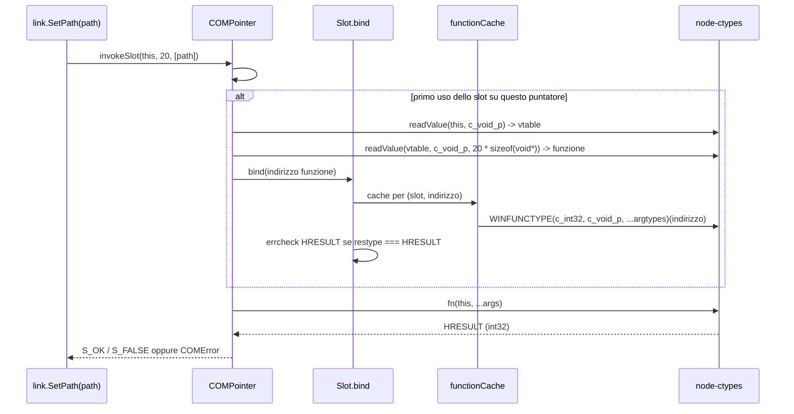

Il binding di un function pointer costa circa 20 µs, la chiamata circa 1 µs. Per questo la
cache e' per slot e per indirizzo: gli oggetti della stessa classe condividono la vtable.
Una cache solo per indirizzo non basterebbe: il linker puo' unificare funzioni
identiche, e slot diversi devono mantenere etichette ed errcheck distinti.

I metodi `HRESULT` sono legati con restype `c_int32`. Con `ctypes.HRESULT`, node-ctypes
lancerebbe un `Error` generico prima dell'errcheck, perdendo metodo e `IErrorInfo`.
Per i metodi COMMETHOD lo slot chiama `spec.marshal` invece della funzione (sezione 10).

## 4. Errori HRESULT e IErrorInfo

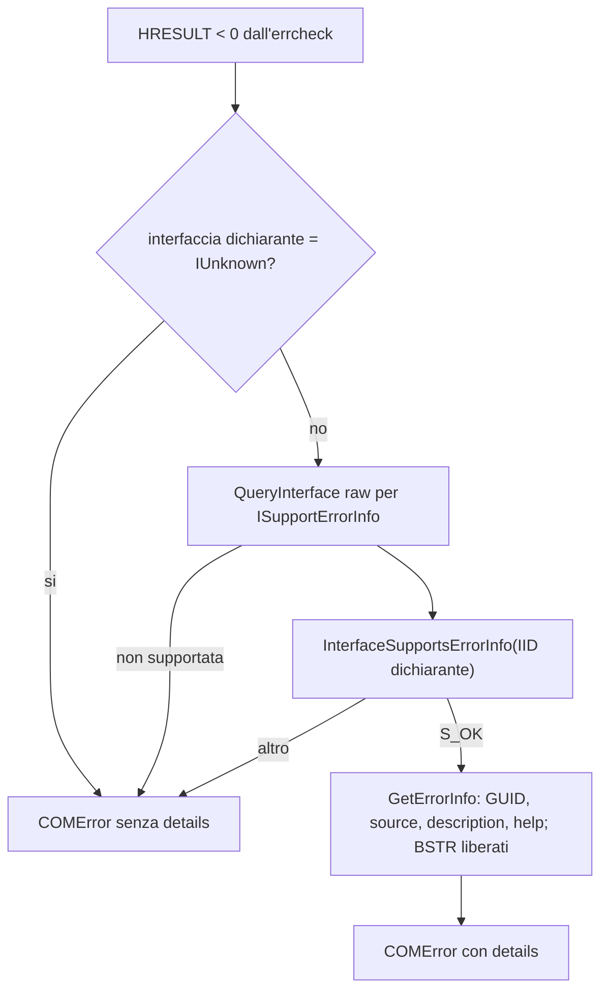

Il percorso d'errore usa solo chiamate raw (`rawQueryInterface`, `rawRelease`) senza
errcheck, quindi niente ricorsione. Qualsiasi eccezione interna produce `details: null`.
`text` arriva da `FormatMessageW` (`ctypes.FormatError`), localizzato dal sistema; per gli HRESULT
`0x800Axxxx` (errori VB) senza testo di sistema, dalle stringhe di vbscript.dll se installata.
Le funzioni libere (`CoCreateInstance`, `CLSIDFromProgID`, ...) usano `checkHRESULT`
senza `IErrorInfo`, come `OleDLL` in Python.

## 5. Ownership dei puntatori

Ogni `COMPointer` possiede un riferimento, registrato in `tracking.ts` come
`{ address, generation, released }`.

| Operazione                                                              | Riferimento                                                           |
| ----------------------------------------------------------------------- | --------------------------------------------------------------------- |
| costruzione (`fromAddress`, QI, `CoCreateInstance`)                     | `track()`: registrato e messo nel `FinalizationRegistry`              |
| `fromAddress(p, iface, { addRef: true })` (puntatore preso in prestito) | come sopra, poi `AddRef`                                              |
| `Release()` / `using`                                                   | `untrack()` e poi `rawRelease()`; il puntatore diventa inutilizzabile |
| `detach()`                                                              | `untrack()` senza `Release`                                           |
| GC del puntatore                                                        | il finalizer rilascia solo se `generation` e' quella corrente         |
| `AddRef()`, `callMethod("Release")`                                     | conteggio raw, non cambia l'ownership                                 |

## 6. Apartment e rilascio finale

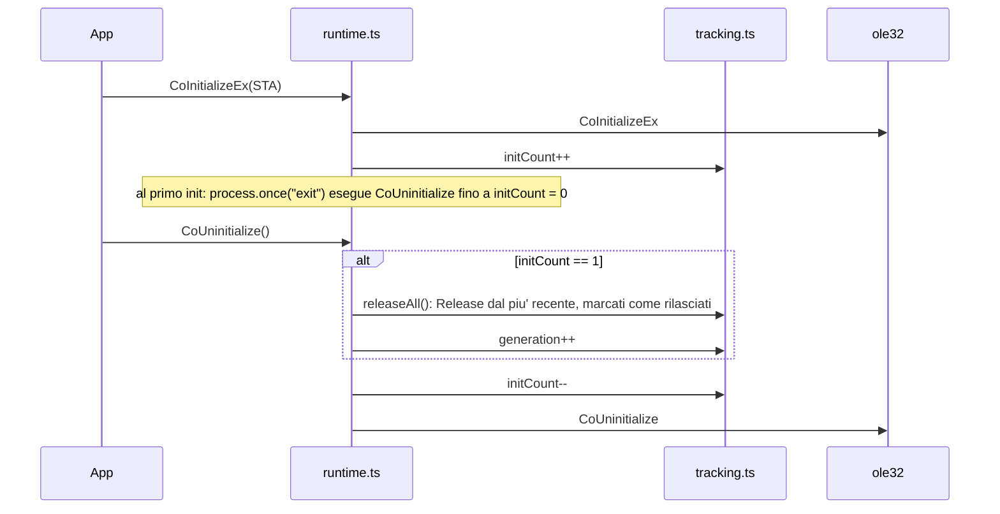

Lo stato e' per thread: ogni worker ha la sua istanza del modulo, quindi apartment,
riferimenti vivi e `FinalizationRegistry` separati.

## 7. VARIANT e SAFEARRAY

Il codec (`automation/variant.ts`) lavora su `Buffer`: una VARIANT JS (`VARIANT._buffer`),
un array di VARIANT per `DISPPARAMS`, oppure una copia della memoria nativa
(`readMemory`/`memmove`). Le conversioni scalari non chiamano DLL, quindi sono testate
anche fuori da Windows; le chiamate native servono solo per BSTR, interfacce, SAFEARRAY e
`VariantClear/Copy/ChangeType`.

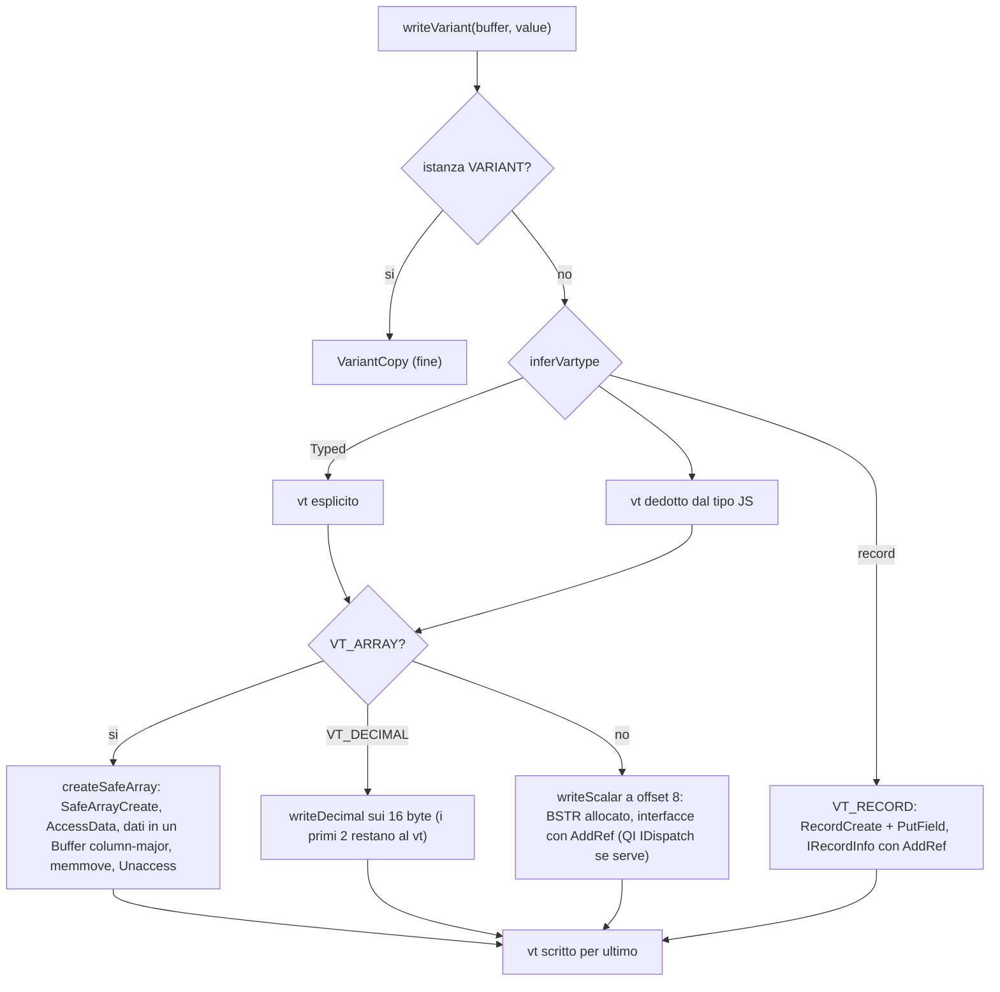

- Ownership: la VARIANT (o l'array) possiede BSTR, riferimenti e SAFEARRAY creati; `clearVariant`
  chiama `VariantClear` solo per i tipi che possiedono risorse.
- Lettura: `VT_BYREF` viene dereferenziato copiando il valore puntato; `VT_DISPATCH`/`VT_UNKNOWN`
  diventano nuovi `COMPointer` con `AddRef`, usando la definizione registrata per l'IID
  (`findInterface`), cosi' il codec non importa i moduli delle interfacce. La conversione in best interface
  o in oggetto dinamico avviene sopra, nel client (sezione 9).
- SAFEARRAY: il primo indice varia piu' velocemente; `values[i][j]` e' l'elemento `(i, j)`.
  In scrittura gli elementi sono preparati in un Buffer e copiati nell'array anche se un valore non e'
  convertibile; in quel caso `createSafeArray` chiama `SafeArrayDestroy`, che libera BSTR e riferimenti gia'
  scritti, e rilancia l'errore. Gli array di record usano `SafeArrayCreateEx` (sezione 18).
- DATE: ora locale "da orologio", calcolata dai componenti locali (non da `getTimezoneOffset`,
  arrotondato ai minuti e sbagliato per gli offset storici LMT); prima del 30/12/1899 la parte
  intera conta all'indietro e la frazione in avanti, come `DateTime.ToOADate`.
- DECIMAL e CY tornano come `number`; `VARIANT.exact` da' il testo decimale esatto (stringa).

## 8. IDispatch::Invoke

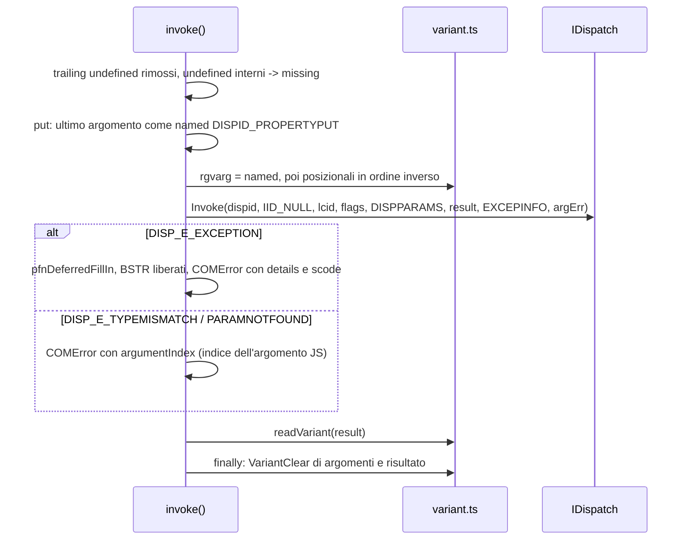

L'errcheck generico di `IDispatch::Invoke` lancia gia' un `COMError`: `invoke` lo intercetta e
lo sostituisce con uno arricchito (`cause` conserva l'originale). Se `EXCEPINFO` ha solo lo
`scode` (runtime Scripting), la descrizione e' il messaggio di sistema dello scode quando esiste,
e lo scode compare nel messaggio. Per i put `pVarResult` e' NULL. `LCID` di default 0, come comtypes
(`setDefaultLCID`).

## 9. Client: best interface e client dinamico

`manage()` (`client/index.ts`, come `comtypes.client._manage`) decide cosa restituiscono `CreateObject`,
`GetObject` e `GetActiveObject`:

- con `interface`: quella interfaccia (`CreateObject` e `GetObject` la chiedono direttamente a
  `CoCreateInstance`/`CoGetObject`);
- con `dynamic: true`: oggetto dinamico (`CreateObject` e `GetObject` chiedono subito `IDispatch`, poi `manage` fa
  `QueryInterface(IDispatch)`);
- `CreateObject(coclass)` senza opzioni: l'oggetto viene creato con `coclass.defaultInterface` e quel puntatore
  e' restituito cosi' com'e', senza `GetBestInterface`;
- altrimenti: oggetto creato con `IUnknown` e passato a `GetBestInterface`; se il risultato e' ancora
  `IDispatch`/`IUnknown` senza tipo, diventa un oggetto dinamico (con `IDispatch`) o resta il puntatore `IUnknown`.

`CreateObject` con `machine` usa `CoCreateInstanceEx` con un `COSERVERINFO`.

`GetBestInterface` (`client/best.ts`, come `comtypes.client.GetBestInterface`) restituisce sempre un nuovo
riferimento; solo i `COMError` vengono intercettati (ripiego: stessa interfaccia), gli altri errori risalgono:

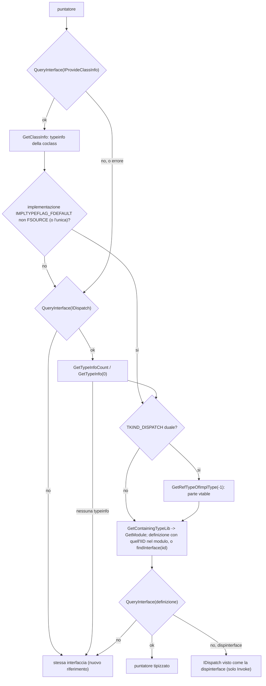

- `GetModule` cerca prima nella cache con il `TLIBATTR`, senza rileggere la libreria (sezione 15).
- `client/best.ts` installa, quando viene caricato, due comportamenti, come `comtypes.client` con
  `wrap_outparam`. Viene caricato dall'entry point principale e da `@node-ctypes/comtypes/client`; chi importa solo
  altri subpath (`/interfaces`, `/typelib`, `/server`, `/automation`) non li ha:
  - `setOutputWrapper(wrapOutparam)`: le uscite delle chiamate tipizzate (out di COMMETHOD, risultati di
    DISPMETHOD, anche dentro gli array) che sono puntatori con interfaccia esattamente `IDispatch` passano da
    `GetBestInterface`; il puntatore originale viene rilasciato. Senza typeinfo diventano oggetti dinamici
    (Python lascia il puntatore `IDispatch`). Le interfacce derivate non vengono toccate. A livello di tipi,
    `OutValue` di `IDispatch` e' `AutomationObject`;
  - `Symbol.iterator` su `IDispatch.Pointer.prototype`: i puntatori tipizzati enumerano `_NewEnum`
    (`iterateNewEnum`), con gli elementi convertiti da `wrapOutparam`.
- Gli helper late-bound (`getProperty`, `putProperty`, `invokeMethod`, ...) accettano anche puntatori tipizzati
  derivati da `IDispatch` (`DispatchTarget`): lo stato (cache dei DISPID) e' in una `WeakMap` per puntatore, e
  i risultati sono oggetti dinamici.
- `Constants(obj)` (`client/constants.ts`): `typeLibOf` (`IProvideClassInfo` o `IDispatch::GetTypeInfo`) ->
  `GetModule`; dal modulo prende i membri degli enum e le costanti dei `module` (il primo nome vince), poi i
  nomi degli enum e degli alias. Il risultato e' un `Proxy` su un oggetto congelato (in cache per modulo) che
  lancia `TypeError` per i nomi sconosciuti, tranne simboli, `then` e `toJSON`.

Con `{ dynamic: true }` (o `Dispatch(pointer)`) si ottiene il client dinamico: un `Proxy` su una funzione
freccia (quindi chiamabile per `DISPID_VALUE`); lo stato e' in una `WeakMap`.

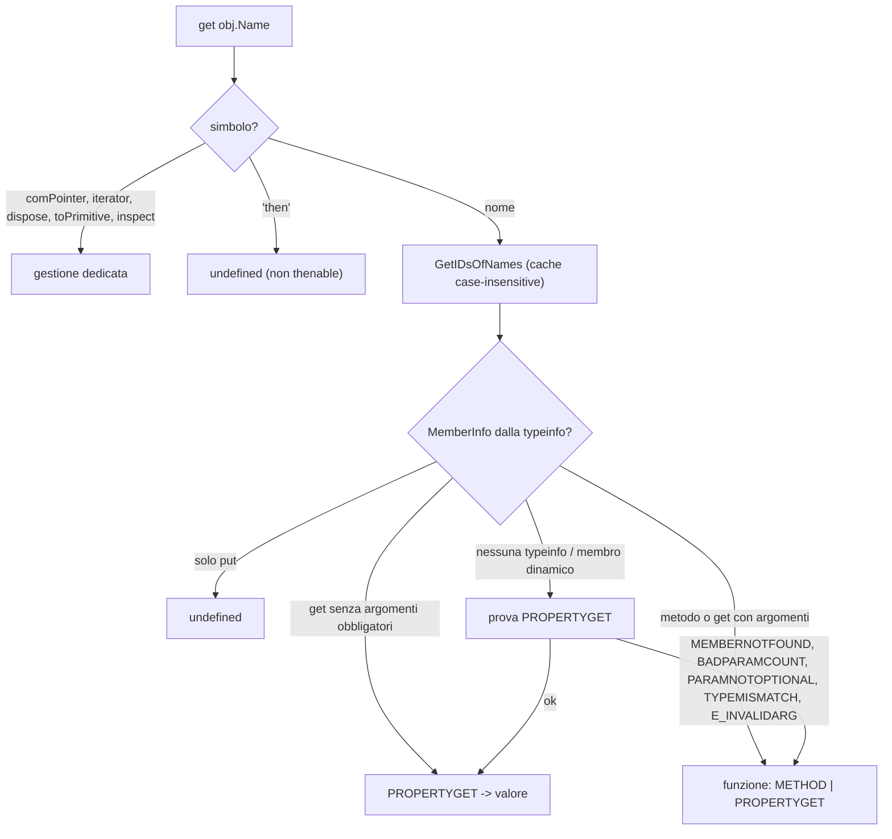

- `MemberInfo` viene da `typeMembers`: FUNCDESC e VARDESC (`VAR_DISPATCH`) del tipo e delle
  basi (`GetRefTypeOfImplType`), in cache per GUID, versione e LCID del tipo (le typeinfo con GUID nullo non
  vanno in cache); i parametri `FOPT`/`FHASDEFAULT`/`FRETVAL`/`FLCID` non contano come obbligatori.
- `set`: valori COM con `PROPERTYPUTREF` se il membro lo supporta (o, senza typeinfo,
  tentativo con ripiego su `PROPERTYPUT`); altrimenti `PROPERTYPUT`.
- I risultati `IDispatch` vengono avvolti di nuovo come oggetti dinamici, anche dentro gli array; ogni proxy
  possiede il proprio riferimento (`using`, `release`, finalizer). `util.inspect` non attraversa i trap:
  il metodo `inspect.custom` e' definito sulla funzione target.
- Enumerazione: `DISPID_NEWENUM` -> `QueryInterface(IEnumVARIANT)` -> `Next(1)` finche' restituisce `S_OK` con un elemento;
  il generatore rilascia l'enumeratore anche con `break`.

## 10. COMMETHOD e idlflags

`COMMETHOD` (`commethod.ts`) produce una `MethodSpec` con:

- `name`: `_get_X` / `_set_X` / `_setref_X` per gli accessor (come comtypes), altrimenti il nome;
  `property`: il nome originale; `kind`: `method`/`propget`/`propput`/`propputref`; `dispid`;
- `argtypes` nativi: `c_void_p` per ogni `out`, il tipo del codec per gli `in`
  (`VARIANT` e le strutture per valore);
- `marshal`: la funzione che lo slot chiama al posto della chiamata diretta.

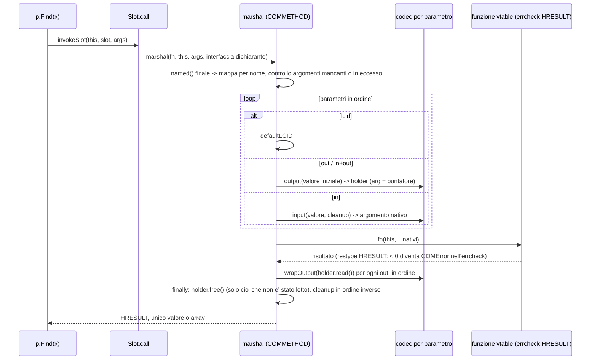

| Codec                | in                                                                                                                                                                                                                                                                    | out (holder)                                                                                          |
| -------------------- | --------------------------------------------------------------------------------------------------------------------------------------------------------------------------------------------------------------------------------------------------------------------- | ----------------------------------------------------------------------------------------------------- |
| `BSTR`               | `SysAllocStringLen`, liberato dopo la chiamata                                                                                                                                                                                                                        | puntatore; letto e liberato; `in/out`: BSTR iniziale che il chiamato puo' sostituire                  |
| `LPOLESTR`           | Buffer UTF-16 terminato                                                                                                                                                                                                                                               | letto e liberato con `CoTaskMemFree`; `in/out` non supportato                                         |
| `VARIANT`            | istanza `VARIANT` passata cosi' com'e'; altri valori in una VARIANT temporanea per valore (`missing` se omessa), poi `VariantClear`                                                                                                                                   | VARIANT letta e pulita                                                                                |
| interfaccia / `SELF` | indirizzo preso in prestito; se l'oggetto non deriva dall'interfaccia, `QueryInterface` temporaneo                                                                                                                                                                    | `COMPointer.fromAddress` (adozione del riferimento); `in/out`: riferimento aggiuntivo per il chiamato |
| `lazy(() => IFoo)`   | come un'interfaccia, risolta alla chiamata                                                                                                                                                                                                                            | come un'interfaccia                                                                                   |
| `SAFEARRAY(vt)`      | `createSafeArray`, distrutto dopo                                                                                                                                                                                                                                     | `readSafeArray` e `SafeArrayDestroy`                                                                  |
| `REFGUID`            | Buffer del `GUID` (stringhe accettate), `GUID_NULL` se omesso                                                                                                                                                                                                         | `GUID`                                                                                                |
| `DATE`               | `c_double` da `Date` o numero OLE                                                                                                                                                                                                                                     | `Date`                                                                                                |
| `CURRENCY`           | `c_int64` (unita' / 10.000) da numero, stringa decimale o bigint                                                                                                                                                                                                      | `number`                                                                                              |
| struttura / `GUID`   | istanza (stringhe accettate per `GUID`) per valore                                                                                                                                                                                                                    | istanza allocata e restituita                                                                         |
| tipo semplice        | invariato (`undefined`: il default del tipo)                                                                                                                                                                                                                          | istanza, `.value`                                                                                     |
| `POINTER(T)`         | puntatori grezzi (`bigint`, Buffer, array node-ctypes, strutture) invariati; per `T` VARIANT, tipo semplice o struttura i valori JS passano da un `T` temporaneo; per `VARIANT*` un `COMPointer` e' un valore e `undefined` una VARIANT vuota, per gli altri `T` NULL | come `T` (solo VARIANT, tipo semplice o struttura)                                                    |

`SELF` si risolve a runtime con l'interfaccia che dichiara lo slot (`SlotOwner.definition`,
assegnata alla fine di `COMInterface`); a livello di tipi `COMInterface` restituisce
`ComInterfaceDef<B, M>`, un'interfaccia ricorsiva che passa se stessa come `Self` a `MethodsOf`.

Proprieta': `COMInterface` raggruppa gli accessor per `property` e installa sul prototype
un accessor JS (getter senza argomenti obbligatori; setter se esiste un put con un solo argomento,
`propputref` per gli oggetti COM quando ci sono entrambi) oppure, per i `propget` con argomenti,
un metodo con il nome della proprieta' (get con argomenti obbligatori). Le firme TypeScript seguono le stesse regole
(`PropertiesOf`): proprieta' `readonly` senza put, metodo per le proprieta' parametrizzate.

`interface.ts` importa solo i tipi di `commethod.ts`, che importa `interface.ts`, `pointer.ts`, il codec VARIANT
e i moduli di supporto (`automation/constants.ts`, `automation/dispatch.ts` per `defaultLCID`, `named.ts`,
`date.ts`, `decimal.ts`, `errors.ts`, `guid.ts`, `low-level`); il client si aggancia dall'alto con
`setOutputWrapper`. Restano due cicli di import a runtime, innocui perche' i simboli si usano solo dopo il
caricamento: `automation/variant.ts` <-> `automation/record.ts` e `server/automation.ts` <-> `server/comobject.ts`.

## 11. DISPMETHOD e DISPPROPERTY

I membri di una dispinterface (`dispMethods`, `dispmethod.ts`) non hanno slot: ogni chiamata passa da
`IDispatch::Invoke` con il DISPID della spec.

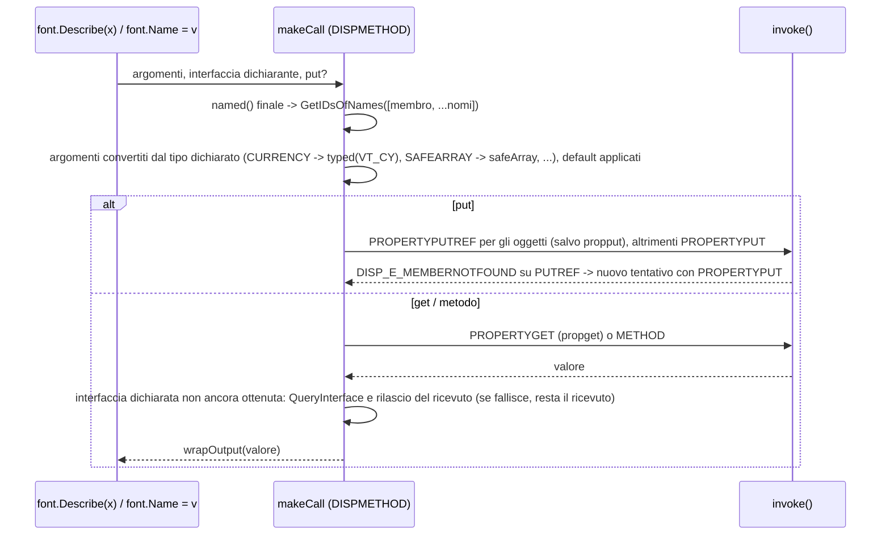

`installDispatchMembers` (`interface.ts`) crea sul prototype le proprieta' JS (`DISPPROPERTY`, `propget`/`propput`
senza argomenti obbligatori) e i metodi; per i `DISPPROPERTY` non `readonly` aggiunge `_set_X`.

## 12. COMObject

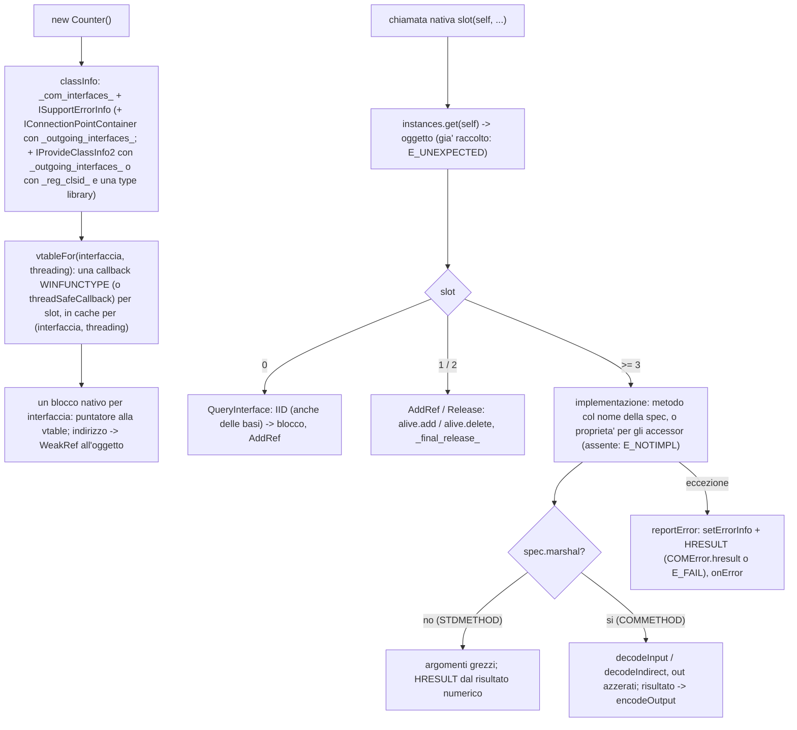

- Gli indirizzi dei blocchi restano risolvibili finche' l'oggetto JS vive (`WeakRef`, pulizia con
  `FinalizationRegistry`); finche' il conteggio nativo e' > 0 l'oggetto e' in `alive`.
- Le callback ricevono i puntatori come indirizzi (`POINTER(T)` diventa `c_void_p`); le VARIANT per
  valore arrivano come istanze `VARIANT` che avvolgono la copia dell'argomento.
- Parametri `[in] POINTER(T)`: `VARIANT*` arriva come valore (`decodeIndirect`), gli altri `T*` come indirizzo
  (spesso array `size_is`). Gli `out` puri vengono azzerati prima della chiamata per BSTR, LPOLESTR, SAFEARRAY,
  interfacce e VARIANT.
- Gli argomenti interfaccia sono `COMPointer` con un riferimento proprio, rilasciati dopo la chiamata.
- Uscite interfaccia: `encodeOutput` fa `AddRef` per il chiamante; il `COMPointer` restituito
  dall'implementazione resta suo (un puntatore creato solo per essere restituito, come quello di
  `GetClassInfo`, viene rilasciato dal finalizer).
- Il protocollo `comReference` presta il primo puntatore dell'oggetto senza `AddRef`: cosi' un
  `COMObject` si passa a VARIANT e a `Dispatch()`, che fanno il proprio `AddRef`, e ai parametri COMMETHOD,
  che prestano l'indirizzo (o un `QueryInterface` temporaneo rilasciato dopo la chiamata).
- Errori: per i metodi `HRESULT`, `reportError` imposta `IErrorInfo` (descrizione, source = `_reg_progid_` o
  nome della classe, GUID dell'interfaccia dichiarante), chiama `onError` e restituisce `COMError.hresult` o
  `E_FAIL`. Per i metodi con altro restype un'eccezione chiama solo `onError` e restituisce 0 (`undefined` se il restype e' `null`).
- `ReturnHRESULT` (come `comtypes.ReturnHRESULT`): un codice di successo viene restituito cosi' com'e'
  (vtable) o come `S_OK` (`Invoke`); un errore riempie `IErrorInfo`/`EXCEPINFO` con il testo. In entrambi i
  casi `onError` non viene chiamato.
- IDispatch (`server/automation.ts`): tabella per classe con i membri di tutte le interfacce derivate da
  `IDispatch`, duali e dispinterface (DISPID delle spec o assegnati), poi i membri JS pubblici su richiesta.
  `GetIDsOfNames` mappa anche i nomi dei parametri (argomenti named -> posizioni) e, se un nome e'
  sconosciuto, scrive `DISPID_UNKNOWN` per tutti e restituisce `DISP_E_UNKNOWNNAME`. `Invoke` legge `DISPPARAMS` (argomenti al contrario, named per DISPID): gli `IDispatch` in
  ingresso diventano oggetti dinamici rilasciati dopo la chiamata; chiama `_invoke_`, scrive `pVarResult`;
  `DISPID_VALUE` usa `_com_default_member_`, `_NewEnum` su un oggetto iterabile restituisce un
  `VariantEnumerator`; `DispatchError` diventa l'HRESULT, le altre eccezioni `EXCEPINFO`/`DISP_E_EXCEPTION`;
  `puArgErr` non viene scritto.
- `GetTypeInfo`: l'`ITypeInfo` della prima interfaccia derivata da `IDispatch` (o di una sua base) costruita da una
  type library (`typeLibLocationOf`); senza, `GetTypeInfoCount` restituisce 0.
  `GetClassInfo` (`IProvideClassInfo`): la typeinfo della coclass `_reg_clsid_` nella type library della classe
  (`classTypeLib`: `_reg_typelib_`/`_typelib_path_`, o la libreria della prima interfaccia), altrimenti
  `E_NOTIMPL` o `TYPE_E_ELEMENTNOTFOUND`. `GetGUID` supporta solo `GUIDKIND_DEFAULT_SOURCE_DISP_IID`.

## 13. Eventi e message pump

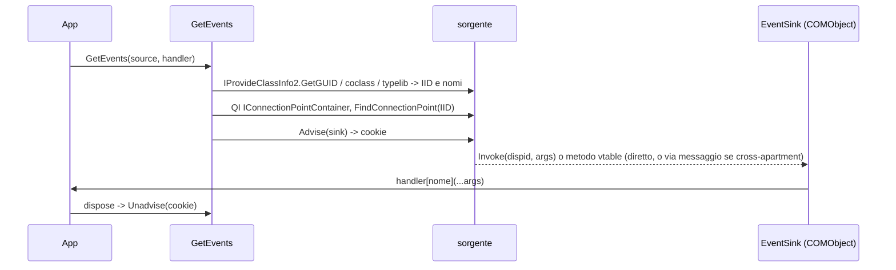

- Il sink e' una sottoclasse di `COMObject` per interfaccia evento (definizione data, registrata con le
  `dispid`, o sintetica dalla type info, non registrata). Per le interfacce vtable inoltra i metodi.
- Consegna: `handler[Nome]`, poi `handler[Interfaccia_Nome]`, poi `handler.onEvent(nome, args)`; gli eventi non
  gestiti sono ignorati. I parametri by-reference arrivano come `ByRef`. `ShowEvents` usa un handler che stampa
  ogni evento (`log` configurabile).
- Sorgenti JS: `ConnectionPoint` conserva i sink (QI all'interfaccia uscente); `fireEvent` usa
  `invoke` per le interfacce derivate da `IDispatch`, duali comprese (dispid della spec, altrimenti
  `GetIDsOfNames`), e `callMethod` per le altre;
  gli errori dei sink vengono raccolti (uno: rilanciato; piu' di uno: `AggregateError`).
- Pump: `startMessagePump` (`setInterval` unref'd con `PeekMessageW`), `waitFor`, `pumpMessages`,
  `PumpEvents` (bloccante, `CoWaitForMultipleHandles` su un evento mai segnalato; `RPC_S_CALLPENDING` = timeout).
  Verificato con gli eventi asincroni di WMI (`SWbemSink`).

## 14. Class factory e LocalServer32

- `ClassFactory` (COMObject `IClassFactory`) crea istanze della classe e risponde con l'IID richiesto.
- `registerClassObject`: `CoRegisterClassObject` (`CLSCTX_LOCAL_SERVER` e `REGCLS_MULTIPLEUSE` di default; COM
  tiene il proprio riferimento), revoca con dispose.
- `registerServer`/`unregisterServer`: chiavi per utente in `HKCU\Software\Classes`:
  - `CLSID\{clsid}\LocalServer32` = eseguibile (`executable`, default `process.execPath`), `execArgv`, script e
    `args`, ognuno tra virgolette solo se contiene spazi o virgolette (COM aggiunge `-Embedding`);
  - descrizione (`_reg_desc_`), `ProgID`, `VersionIndependentProgID` (`_reg_novers_progid_`, con `CurVer`) e le
    chiavi dei ProgID;
  - con una type library (`_reg_typelib_`, oppure quella da cui sono costruite le interfacce): `TypeLib` e
    `Version` (decimale), e il file (`_typelib_path_` o il file letto da `GetModule`) registrato con
    `RegisterTypeLibForUser`, salvo `typelib: false`. `unregisterServer` lo rimuove con `UnRegisterTypeLibForUser`
    se il file e' noto (salvo `typelib: false`), ignorando gli errori (libreria gia' rimossa).
- `UseCommandLine(classes)` (asincrona): switch con `/` o `-`, in qualunque maiuscolo; nell'ordine
  `/unregserver`, `/regserver` (script = `process.argv[1]`, con `process.execArgv`), `-Embedding` ->
  `runLocalServer`; senza switch stampa l'uso e restituisce `false`.
- `runLocalServer`: STA, class factory `CLSCTX_LOCAL_SERVER`/`REGCLS_MULTIPLEUSE`, ciclo asincrono che pompa i
  messaggi ogni `interval` (5 ms). Il timer di inattivita' (`idleTimeout`, 2 s) parte dopo il primo oggetto
  servito; se nessun oggetto viene creato entro `startupTimeout` (60 s) termina comunque. Poi revoca le class
  factory, chiama `CoUninitialize` e ritorna (non chiama `process.exit`). Le chiamate cross-process arrivano
  come messaggi.
- `COMObject` con `_reg_clsid_` e una type library implementa `IProvideClassInfo2` (sezione 12), cosi' il
  client ottiene l'interfaccia di default tipizzata.

Marshaling tra processi di un'interfaccia vtable custom:

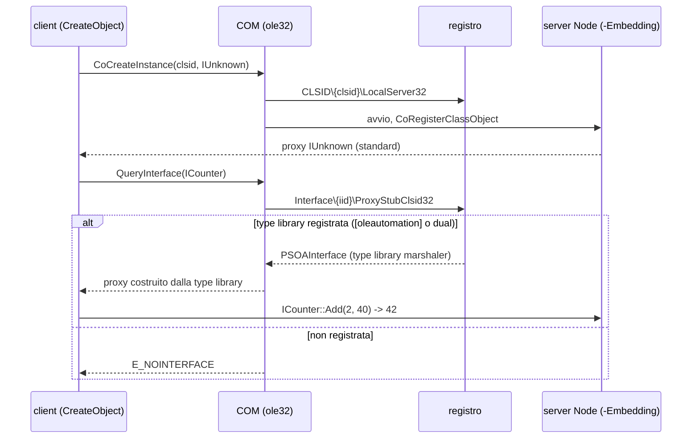

`IDispatch` ha sempre un proxy di sistema; per le interfacce custom la registrazione della type library e'
indispensabile. Le type library si possono scrivere senza MIDL con `createTypeLib` (`CreateTypeLib2`,
`ICreateTypeLib2`/`ICreateTypeInfo`): i test costruiscono cosi' la libreria del server
(`tests/fixtures/typelib.ts`). `registerTypeLib(file, { scope })` usa `RegisterTypeLibForUser` (o
`RegisterTypeLib` per `"machine"`) con il percorso assoluto e restituisce `{ libid, major, minor, lcid }` dal
`TLIBATTR`; `unregisterTypeLib` usa il `SYSKIND` del processo (`SYS_WIN64` su x64 e ARM64).

## 15. Type library

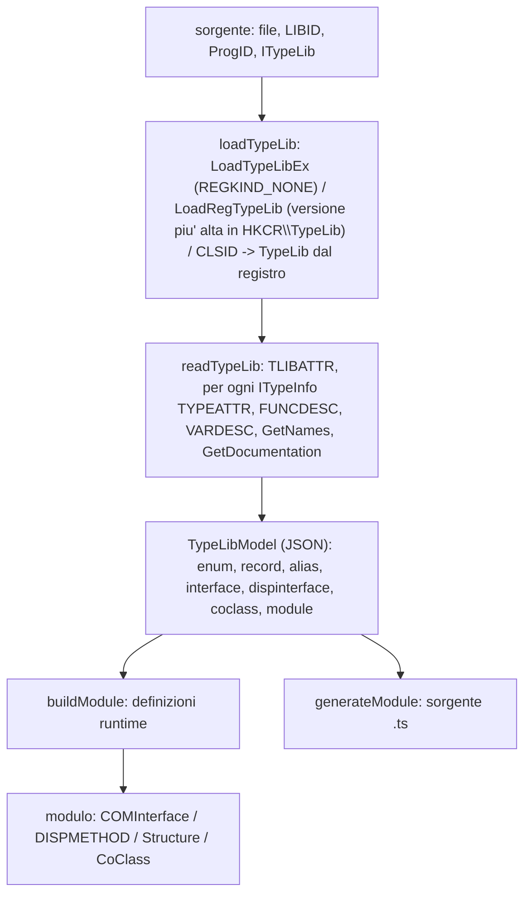

- Tipi (`TypeRef`): `vt`, `ptr`, `safearray`, `carray` (ARRAYDESC), `user` (HREFTYPE risolto con
  `GetRefTypeInfo`: nome, TYPEKIND, GUID e libreria). Gli alias esterni sono sostituiti dalla loro definizione;
  enum e interfacce esterne restano riferimenti per nome (fallback `IDispatch`/`IUnknown` o una definizione gia' caricata).
- Duali: il TKIND_DISPATCH con `TYPEFLAG_FDUAL` viene descritto dal lato vtable (implemented type -1), con gli slot
  (`oVft`); i membri ereditati di IUnknown/IDispatch delle dispinterface sono scartati.
- Build (`build.ts`): interfacce predefinite riusate per IID (sezione 17); riferimenti a interfacce locali con
  `lazy()` (cicli ammessi); ordine delle basi ricorsivo; slot mancanti riempiti con segnaposto `_slotN`; nomi
  duplicati con il numero dello slot come suffisso (`Nome_N`); parametri: `out` toglie un livello di puntatore, `IFoo*` diventa
  l'interfaccia, `GUID*` `REFGUID`, `VT_DATE`/`VT_CY` `DATE`/`CURRENCY`, record per valore classi `Structure`
  (`_pack_` se la dimensione non coincide). Le dispinterface diventano `DISPPROPERTY`/`DISPMETHOD` su `IDispatch`.
  L'interfaccia di default di una coclass e' quella `[default]`, altrimenti la prima, altrimenti `IDispatch`. I
  record con GUID ricevono `setRecordTypeInfo` (sezione 18). Gli alias locali esportano lo stesso oggetto del
  bersaglio.
- `GetModule(source, { cacheDir })`: carica la libreria, legge `TLIBATTR` e restituisce il modulo in cache per
  LIBID, versione e LCID senza rileggere la libreria; altrimenti `readTypeLib` e `buildModule`. Il percorso
  del file viene ricordato solo per le sorgenti file (`.dll`, `.tlb`, `.olb`, `.ocx`, `.exe`, anche con `\N`) e solo
  alla prima costruzione: se il modulo e' gia' in cache da un'altra sorgente, resta senza percorso. Accetta anche
  un `TypeLibModel`. Con `cacheDir` (o `NODE_COMTYPES_CACHE`) scrive anche
  `<Library>.ts` senza sovrascrivere; le coppie libreria/cartella gia' scritte sono ricordate, quindi la
  rilettura completa avviene una sola volta.
- `COMObject`: se un'interfaccia viene da una type library (`typeLibLocationOf`), `GetTypeInfo` restituisce
  l'`ITypeInfo` (libreria caricata una volta per LIBID/versione/LCID).

## 16. Generazione dei moduli

Il modulo generato contiene il modello come stringa JSON e chiama `buildModule` all'import: il comportamento
runtime coincide con `GetModule`, ma le definizioni sono oggetti propri (non quelli della cache di `GetModule`)
e non conoscono il file della libreria: per registrare il file con un server serve `_typelib_path_`.

I tipi TypeScript sono ricavati dalle spec costruite (`ParamInfo`, `classifyParamType`, `valueType`), non dal
modello, quindi seguono le stesse regole del runtime: argomenti `in` (opzionali solo in coda), risultato
HRESULT / valore / tupla, proprieta' (`readonly` senza put, metodo se il get ha argomenti obbligatori), `Omit`
dei membri ridefiniti rispetto alla base, uscite `IDispatch` tipizzate come `AutomationObject` (come `OutValue`).
Gli enum sono oggetti con membri letterali e un tipo unione dei valori.
Gli import dal pacchetto hanno il suffisso `$`, i nomi riservati il suffisso `_`. `--js` compila con l'API di
TypeScript (`paths` verso le dichiarazioni della CLI, per cartelle fuori da un progetto).

## 17. Interfacce predefinite

`src/interfaces` definisce le interfacce di sistema; `buildModule` le riusa per IID invece di ricostruirle
dalle type library (`builtinInterfaceDefs`).

- Core e automation: `IUnknown`, `IClassFactory`, `IErrorInfo`/`ICreateErrorInfo`/`ISupportErrorInfo`,
  `IDispatch`, `IEnumVARIANT`, `ITypeInfo`, `ITypeLib`, `ITypeComp`, `IProvideClassInfo(2)`,
  `IConnectionPoint(Container)` e i loro enumeratori.
- `typeinfo.ts`: anche `ICreateTypeInfo`, `ICreateTypeLib`, `ICreateTypeLib2`, usate da `createTypeLib`. I metodi
  con strutture (`AddFuncDesc`, `AddVarDesc`, `SetTypeDescAlias`, `SetTypeIdldesc`) e `SetFuncAndParamNames`
  (array di `LPOLESTR`) sono raw.
- `persist.ts` (`comtypes.persist`): `IPersist`, `IPersistFile`, `IPropertyBag` (`Read(name, initial?, errorLog?)`
  con `[in, out, optional] VARIANT`; `Write(name, value)` con `POINTER(VARIANT)`), `IPersistPropertyBag`,
  `IPropertyBag2` (`Read`, `Write` e `GetPropertyInfo` raw: array di `PROPBAG2`/VARIANT), `IPersistPropertyBag2`,
  `IErrorLog`.
- `servprov.ts`: `IServiceProvider` con `QueryService` raw e `queryService(object, sid, IFoo)`, che presta il
  riferimento dell'oggetto, chiede `IServiceProvider` e adotta il puntatore restituito.
- `viewobject.ts` (`comtypes.viewobject`): `IViewObject` (`Freeze`/`Unfreeze` COMMETHOD, il resto raw: HDC,
  rettangoli, target device, advise sink), `IViewObject2.GetExtent` con `SIZEL` in uscita.
- `shelllink.ts` (`comtypes.shelllink`): `IShellLinkW`/`IShellLinkA` raw (buffer del chiamante) e la coclass
  `ShellLink`, un oggetto `CoClass` congelato: `CreateObject(ShellLink)` restituisce `IShellLinkW`.
- `stream.ts`: `ISequentialStream`, `IStream` con COMMETHOD (`STATSTG` in uscita, `SELF` per `Clone`).

## 18. ByRef, record e thread

- `byRef(value, vt?)` (client): `invoke` scrive in `rgvarg` `VT_BYREF | VT_VARIANT` (o `| vt`) verso una
  VARIANT di appoggio; dopo la chiamata ne legge il valore in `.value` e la pulisce (il chiamato puo'
  aver sostituito BSTR o interfacce).
- Server (`COMObject`): per gli argomenti `VT_BYREF`, `InvokeArguments.references` ha un `ByRef` con il
  valore iniziale; se `_invoke_` cambia `value`, `writeReference` rilascia il valore precedente e scrive il
  nuovo nella memoria del chiamante. Gli handler degli eventi ricevono i `ByRef` al posto dei valori.
- `VT_RECORD` (`automation/record.ts`): `IRecordInfo` chiamata per slot vtable; lettura con `GetFieldNames`
  e `GetField` in un oggetto JS (con `recordInfo` non enumerabile), scrittura con `RecordCreate` +
  `PutField`; SAFEARRAY con `SafeArrayCreateEx` / `SafeArrayGetRecordInfo` (distrutto se la scrittura fallisce).
  Le classi record costruite da una type library sanno ricavare il proprio `ITypeInfo` (`setRecordTypeInfo`);
  un wrapper per tipo.
- Thread (`threads.ts`): `CoMarshalInterThreadInterfaceInStream` / `CoGetInterfaceAndReleaseStream`
  (token monouso con l'indirizzo dell'`IStream`) e Global Interface Table. Le chiamate verso un oggetto
  STA arrivano come messaggi al thread proprietario: serve il pump. Verificato con worker STA e MTA che
  chiamano un `COMObject` del thread principale.

## 19. Limitazioni note

- Le chiamate sono sincrone e bloccano l'event loop; i messaggi Win32 vanno pompati esplicitamente
  (`startMessagePump`, `PumpEvents`).
- `_threading_ = "free"`: le chiamate da altri thread aspettano il thread JS; se questo e' bloccato in una
  chiamata COM sincrona che le provoca, deadlock.
- I `COMObject` forniscono type info solo per interfacce costruite da una type library.
- InprocServer32 non e' realizzabile (Node non si carica da una DLL), quindi `_reg_threading_` e `_reg_clsctx_`
  non hanno equivalente; le interfacce vtable custom tra processi richiedono la type library registrata
  (`registerServer` lo fa) o un proxy/stub.
- I membri dei puntatori tipizzati sono quelli della type library: le proprieta' dinamiche (WMI, `IDispatchEx`)
  richiedono `{ dynamic: true }`, come in Python. Un membro inesistente su un puntatore tipizzato e' `undefined`
  (in Python `AttributeError`); i puntatori tipizzati non sono chiamabili per `DISPID_VALUE`.
- La conversione delle uscite `IDispatch` e l'iterazione dei puntatori tipizzati richiedono il caricamento del
  client (entry point principale o `@node-ctypes/comtypes/client`).
- `named()` nelle chiamate COMMETHOD e' solo runtime: la firma statica e' posizionale.
- Gli array C (`size_is`) non hanno un codec: si usano STDMETHOD o `POINTER(T)` con buffer propri.
- Una proprieta' con soli argomenti opzionali viene letta come valore (giusto per Excel `Range.Value`);
  per passarle argomenti serve `getProperty(obj, name, ...args)`.
- `VT_RECORD` richiede un record con GUID nella type library (vincolo di `IRecordInfo`); i campi dei record
  istanziati come classi `Structure` contengono valori nativi (un campo BSTR e' un puntatore).
- I messaggi degli errori VB (`0x800Axxxx`) vengono da vbscript.dll, una Feature on Demand: senza, resta
  il codice.
- Il modulo restituito da `GetModule` non e' tipizzato: per i tipi statici si genera il modulo.
- `wintypes.DWORD`/`LONG`/`ULONG` sono `bigint` in node-ctypes: le interfacce usano `c_uint32`/`c_int32`.
- Il runtime Scripting (FSO, Dictionary) e la Shell non implementano `ISupportErrorInfo`: per le chiamate
  vtable i `details` sono `null`. Il percorso e' verificato con MSXML 6.
- Su Windows (Node 26), un processo che chiama `CoUninitialize` subito dopo molto lavoro (per esempio la CLI dopo
  `readTypeLib`) puo' terminare raramente con `Assertion failed: !(handle->flags & UV_HANDLE_CLOSING)` in
  `src\win\async.c`, dopo aver completato il lavoro. Non si riproduce senza GC concorrente
  (`--single-threaded-gc`) ne' con una breve attesa prima dell'uscita: e' una corsa all'uscita fra i thread
  di V8 e il loop di Node, non un errore del codice COM.

## Riferimenti al codice

- [src/interface.ts](./src/interface.ts): `STDMETHOD`, `COMInterface`, `installProperties`, `installDispatchMembers`, registro IID, tipi `InterfacePointer`.
- [src/pointer.ts](./src/pointer.ts): `COMPointer`, `createSlot`, errcheck.
- [src/tracking.ts](./src/tracking.ts): riferimenti, generazioni, finalizer.
- [src/runtime.ts](./src/runtime.ts): apartment e creazione oggetti.
- [src/errors.ts](./src/errors.ts), [src/errorinfo.ts](./src/errorinfo.ts): `COMError`, messaggi VB, `IErrorInfo`.
- [src/guid.ts](./src/guid.ts): `GUID`.
- [src/low-level](./src/low-level): binding lazy, accesso vtable raw, BSTR e memoria, registro (`registry.ts`).
- [src/automation/variant.ts](./src/automation/variant.ts): `VARIANT`, codec, SAFEARRAY.
- [src/automation/date.ts](./src/automation/date.ts), [src/automation/decimal.ts](./src/automation/decimal.ts): DATE, DECIMAL, CY.
- [src/automation/dispatch.ts](./src/automation/dispatch.ts): `getIDsOfNames`, `invoke`; [src/automation/types.ts](./src/automation/types.ts): `DISPPARAMS`, `EXCEPINFO`.
- [src/automation/members.ts](./src/automation/members.ts): typeinfo, `MemberInfo`.
- [src/automation/record.ts](./src/automation/record.ts): `IRecordInfo`, `record`.
- [src/commethod.ts](./src/commethod.ts): `COMMETHOD`, tipi di parametro, codec, marshal, `setOutputWrapper`.
- [src/dispmethod.ts](./src/dispmethod.ts): `DISPMETHOD`, `DISPPROPERTY`.
- [src/client/index.ts](./src/client/index.ts): `CreateObject`, `GetObject`, `GetActiveObject`, `manage`.
- [src/client/best.ts](./src/client/best.ts): `GetBestInterface`, `wrapOutparam`, iterazione dei puntatori tipizzati.
- [src/client/constants.ts](./src/client/constants.ts): `Constants`.
- [src/client/dynamic.ts](./src/client/dynamic.ts): proxy dinamico, helper late-bound, `iterateNewEnum`.
- [src/client/events.ts](./src/client/events.ts): `GetEvents`, `ShowEvents`.
- [src/server/comobject.ts](./src/server/comobject.ts): `COMObject`, vtable, `classTypeLib`, `VariantEnumerator`, `ConnectionPoint`, `ClassFactory`.
- [src/server/automation.ts](./src/server/automation.ts): IDispatch lato server, `DispatchError`, `ReturnHRESULT`.
- [src/server/marshal.ts](./src/server/marshal.ts): decodifica e codifica dei parametri lato server.
- [src/server/errorinfo.ts](./src/server/errorinfo.ts): `setErrorInfo`.
- [src/server/register.ts](./src/server/register.ts): `registerClassObject`, `registerServer`, `UseCommandLine`, `runLocalServer`.
- [src/pump.ts](./src/pump.ts): message pump.
- [src/threads.ts](./src/threads.ts): marshaling tra thread, GIT.
- [src/typelib](./src/typelib): caricamento e registrazione (`load.ts`), modello, build, generatore, `GetModule`; [src/cli.ts](./src/cli.ts): CLI.
- [src/interfaces](./src/interfaces): interfacce predefinite (`dispatch.ts`, `typeinfo.ts`, `persist.ts`, `servprov.ts`, `viewobject.ts`, `shelllink.ts`, `stream.ts`, ...).
